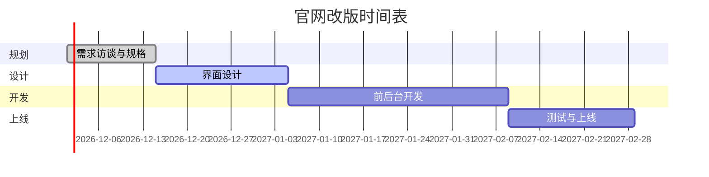

# 【项目名称】例：官网改版项目

| 项目 | 内容 |
| :--- | :--- |
| 项目负责人 | 王小明 |
| 项目周期 | 2026/12/01 – 2027/02/28 |
| 当前状态 | 🟢 进行中 |
| 预算 | 人民币 15 万元 |

---

## 一、项目目标

> [!tip] 写目标的小技巧
> 目标要**具体、可衡量、有期限**。例：「3 个月内把手机端下单转化率从 2.1% 提升到 3%」。

1. 例：改善手机端浏览体验，跳出率降低 20%。
2. 例：下单流程从 5 步缩短为 3 步。
3. 例：后台改为运营人员可以自行更新内容。

## 二、项目范围

| 包含 ✅ | 不包含 ❌ |
| :--- | :--- |
| 首页、商品页、结算页改版 | 会员系统重写 |
| 手机端版式调整 | 新增多语言 |
| 后台内容管理 | 线下门店系统对接 |

## 三、里程碑时间表

## 四、工作分工

| 工作项 | 负责人 | 协作人 | 截止日 |
| :--- | :---: | :---: | :---: |
| 需求访谈与规格说明书 | 王小明 | 林美玲 | 2026/12/14 |
| 界面设计与设计规范 | 林美玲 | - | 2027/01/04 |
| 前端与后台开发 | 张志豪 | 外包团队 | 2027/02/08 |
| 测试、上线与培训 | 陈大华 | 全体 | 2027/02/28 |

## 五、风险与应对

| 风险 | 可能性 | 影响 | 应对方式 |
| :--- | :---: | :---: | :--- |
| 开发中途需求变更 | 中 | 高 | 规格书签字确认后，变更需负责人同意并评估工期 |
| 外包团队人手不足 | 低 | 高 | 提前确认备用人员 |
| 上线撞上促销高峰 | 中 | 中 | 避开大促，选择低峰时段上线 |

> [!warning] 提醒
> 建议每两周检查一次风险表，有新风险随时补充。

## 六、沟通与汇报

* **例会**：每周一 10:00 项目周会（30 分钟）
* **进度汇报**：每周五下班前更新进度表
* **问题反馈渠道**：项目群，紧急事项直接电话联系负责人

## 七、本周待办

- [x] 完成需求访谈
- [ ] 确认设计稿第一版
- [ ] 安排外包团队开工会
