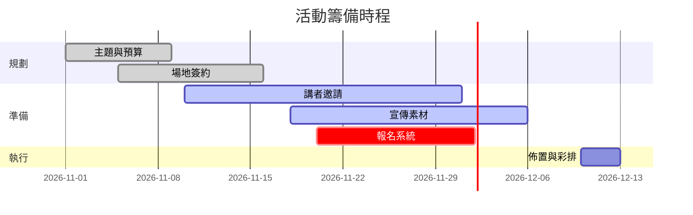

# 【專案或計畫名稱】例：年度活動籌備進度表

最後更新：2026/11/24　｜　整體進度：**45%**

> [!note] 狀態說明
> ✅ 已完成　🔄 進行中　⏳ 未開始　⚠️ 延遲

---

## 一、進度總覽

| 階段 | 工作項目 | 負責人 | 開始 | 截止 | 狀態 | 進度 |
| :--- | :--- | :---: | :---: | :---: | :---: | ---: |
| 規劃 | 確認活動主題與預算 | 王小明 | 11/01 | 11/08 | ✅ | 100% |
| 規劃 | 場地洽詢與簽約 | 陳大華 | 11/05 | 11/15 | ✅ | 100% |
| 準備 | 講者邀請 | 林美玲 | 11/10 | 11/30 | 🔄 | 60% |
| 準備 | 宣傳素材設計 | 張志豪 | 11/18 | 12/05 | 🔄 | 30% |
| 準備 | 報名系統建置 | 張志豪 | 11/20 | 12/01 | ⚠️ | 10% |
| 執行 | 現場佈置與彩排 | 全體 | 12/10 | 12/12 | ⏳ | 0% |

## 二、時程圖

## 三、本週完成

- [x] 場地合約簽署完成
- [x] 確認 3 位講者
- [ ] 宣傳海報初稿（延到下週一）

## 四、下週計畫

- [ ] 完成講者邀請（剩 2 位）
- [ ] 宣傳素材定稿
- [ ] 報名系統測試上線

## 五、問題與需要協助

> [!warning] 報名系統進度落後
> 例：金流串接文件尚未取得，預計延遲 3 天。需請主管協助聯繫金流廠商。
