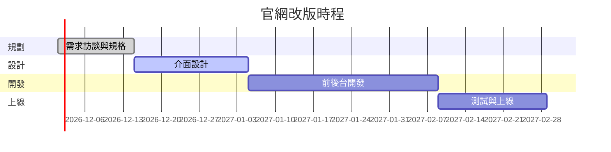

# 【專案名稱】例：官網改版專案

| 項目 | 內容 |
| :--- | :--- |
| 專案負責人 | 王小明 |
| 專案期間 | 2026/12/01 – 2027/02/28 |
| 目前狀態 | 🟢 進行中 |
| 預算 | 新台幣 60 萬元 |

---

## 一、專案目標

> [!tip] 寫目標的小技巧
> 目標要**具體、可衡量、有期限**。例：「3 個月內讓手機版結帳轉換率從 2.1% 提升到 3%」。

1. 例：改善手機版瀏覽體驗，跳出率降低 20%。
2. 例：結帳流程從 5 步縮短為 3 步。
3. 例：網站後台改為行銷人員可自行更新內容。

## 二、專案範圍

| 包含 ✅ | 不包含 ❌ |
| :--- | :--- |
| 首頁、商品頁、結帳頁改版 | 會員系統重寫 |
| 手機版版面調整 | 新增多國語言 |
| 後台內容管理 | 實體門市系統串接 |

## 三、里程碑時程

## 四、工作分工

| 工作項目 | 負責人 | 協作者 | 截止日 |
| :--- | :---: | :---: | :---: |
| 需求訪談與規格書 | 王小明 | 林美玲 | 2026/12/14 |
| 介面設計與設計規範 | 林美玲 | - | 2027/01/04 |
| 前端與後台開發 | 張志豪 | 外包團隊 | 2027/02/08 |
| 測試、上線與教育訓練 | 陳大華 | 全體 | 2027/02/28 |

## 五、風險與因應

| 風險 | 可能性 | 影響 | 因應方式 |
| :--- | :---: | :---: | :--- |
| 需求在開發中途變更 | 中 | 高 | 規格書簽核後，變更需經負責人同意並評估時程 |
| 外包團隊人力不足 | 低 | 高 | 預先確認備援人力 |
| 上線時遇到檔期高峰 | 中 | 中 | 避開檔期，選擇離峰時段上線 |

> [!warning] 提醒
> 風險表建議每兩週檢視一次，新的風險隨時補上。

## 六、溝通與回報

* **例行會議**：每週一 10:00 專案週會（30 分鐘）
* **進度回報**：每週五下班前更新進度表
* **問題回報管道**：專案群組，緊急事項直接電話聯絡負責人

## 七、本週待辦

- [x] 完成需求訪談
- [ ] 確認設計稿第一版
- [ ] 安排外包團隊開工會議
